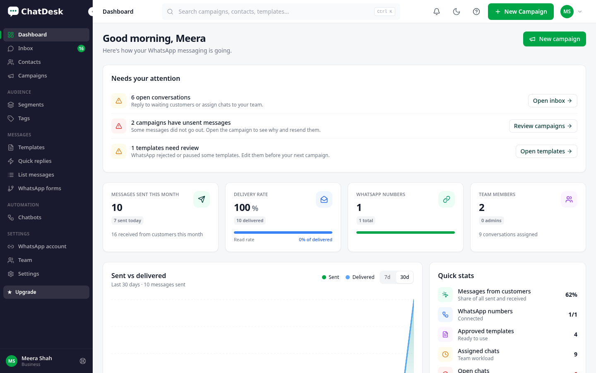
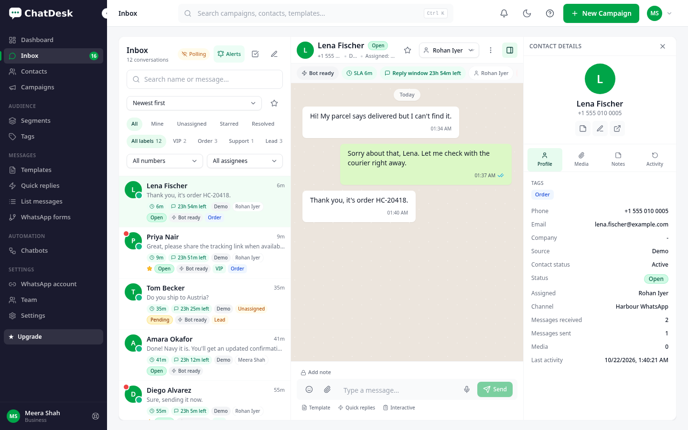
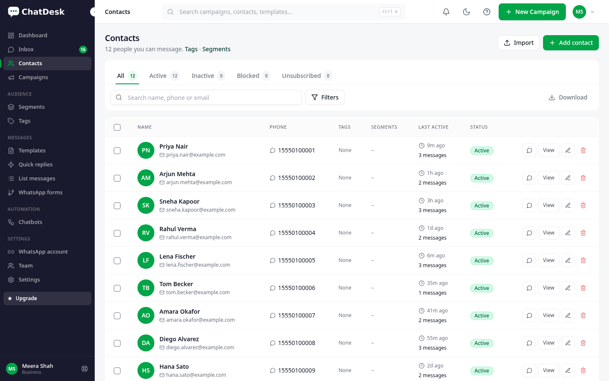
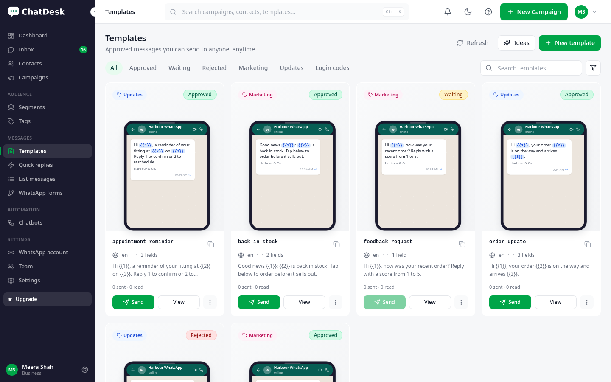
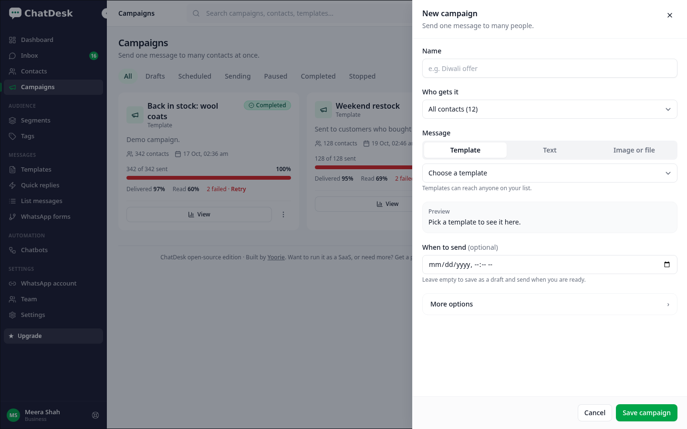
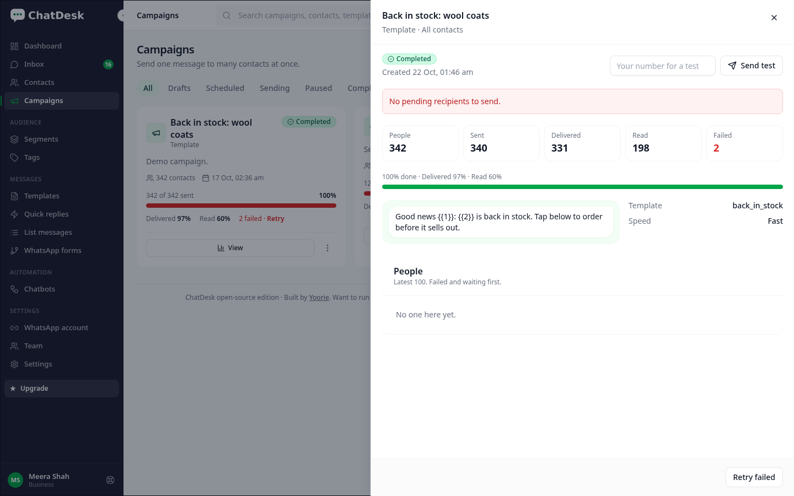
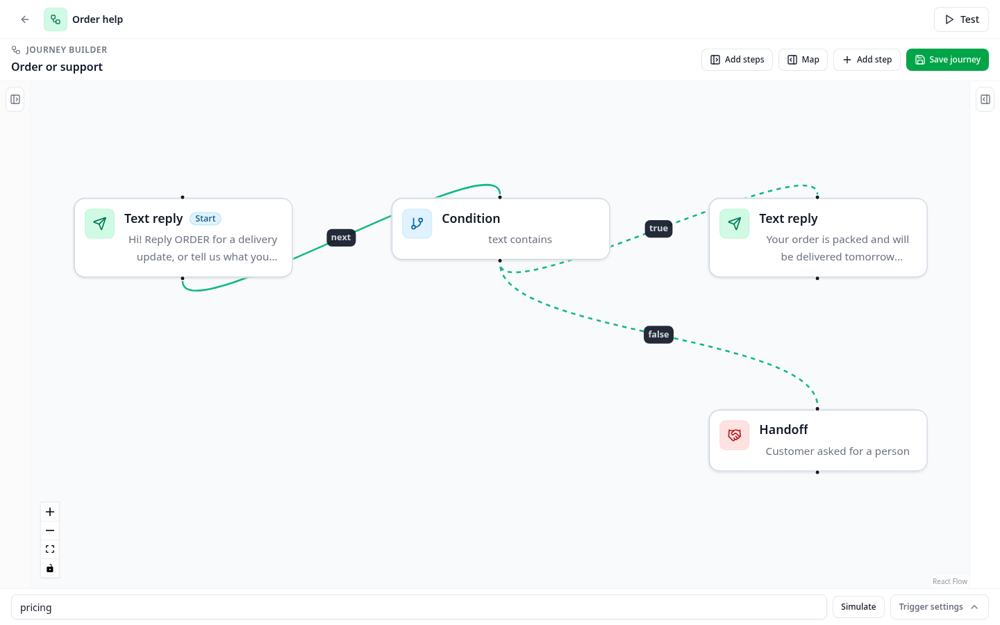
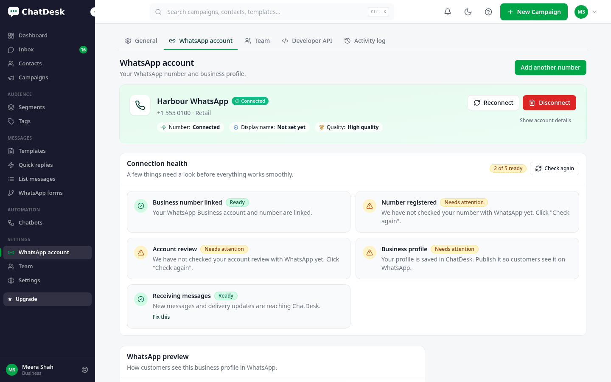
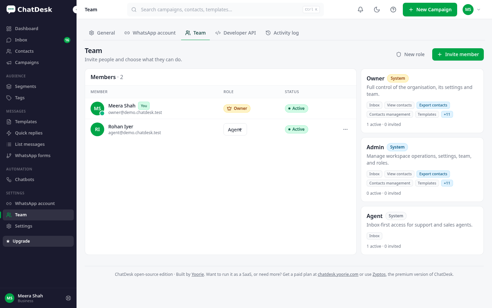

<div align="center">

# ChatDesk

**Self-hosted WhatsApp Cloud API inbox for your business. Open source, built with Laravel.**

**Built by [Yoorie](https://yoorie.com)** · [Live demo](https://demo.yoorie.com/chatdesk) · [Docs](https://demo.yoorie.com/chatdesk/docs/) · [Connect WhatsApp guide](docs/connect-whatsapp.md)

[](LICENSE)


</div>

> **Want to run it as a SaaS, or need more?** Get a paid plan at **[chatdesk.yoorie.com](https://chatdesk.yoorie.com)**
> or use **[Zyptos](https://zyptos.com)**, the premium version of ChatDesk.

---

## What is ChatDesk?

ChatDesk is a self-hosted shared inbox for the official **WhatsApp Cloud API**. Install it on your
own server, connect your business number with your own Meta app, and your whole team can chat with
customers, send template broadcasts and run keyword chatbots, all from one place.

This open-source edition is built for **one organisation**: one install = one business, with an
admin and as many team users and agents as you need. Your data stays on your server.

## Features

**Shared inbox**
- Every WhatsApp message type: text, images, video, audio and voice notes, documents, stickers,
  location, contact cards, reactions, interactive reply buttons, list messages and CTA URL buttons
- Assign chats to agents, internal notes, quick replies, unread counts, search, read receipts
- Real-time updates (optional Pusher) with a polling fallback for shared hosting
- 24-hour customer service window handling, with a template picker when the window is closed

**Campaigns / broadcasts**
- Send approved template messages to contact lists, tags or segments
- Schedule for later, pause, resume, retry failed, send a test first
- Delivery and read stats per campaign and per recipient
- Opt-out keywords (STOP / START) respected automatically

**Chatbots and auto-replies**
- Keyword triggers and welcome / away messages
- Visual flow builder with buttons, lists, conditions and hand-off to a human
- Pause the bot per chat from the inbox

**Templates**
- Sync from Meta, create new templates (text, media headers, buttons), submit for approval,
  track status and quality

**Contacts**
- Contacts with tags, custom fields, notes and segments
- CSV import with error report, export, merge duplicates

**Team**
- Admin plus team users and agents with basic roles (owner, admin, agent)
- Invite by email; agents only see the inbox
- Two-factor login, activity log

**Developers**
- REST API (API keys) to send messages and read conversations
- Outgoing webhooks for your own systems

## Screenshots

Taken from a local install with fictional demo data (`php artisan db:seed --class=DemoSeeder`).

| Dashboard | Inbox |
| --- | --- |
|  |  |
| **Contacts** | **Templates** |
|  |  |
| **Campaign builder** | **Campaign stats** |
|  |  |
| **Chatbot flow builder** | **WhatsApp connection** |
|  |  |
| **Team** | |
|  | |

## Open source vs ChatDesk paid plans / Zyptos

| | **ChatDesk open source** (this repo) | **ChatDesk paid plans / Zyptos** |
| --- | :---: | :---: |
| Organisations | Single organisation | **Multi-tenant SaaS** (sell to your own customers) |
| Team users & agents | ✅ | ✅ |
| Shared inbox, all message types | ✅ | ✅ |
| Contacts, tags, segments, import | ✅ | ✅ |
| Templates (sync, create, submit) | ✅ | ✅ |
| Campaigns / broadcasts | ✅ Basic | ✅ Advanced |
| Chatbots, keyword flows | ✅ | ✅ |
| WhatsApp numbers | Manual Cloud API setup | Embedded Signup (one-click Facebook login), multiple numbers |
| Billing, plans & subscriptions | — | ✅ |
| Payment gateways (Stripe, PayPal, Razorpay, UPI, bank) | — | ✅ |
| Super-admin panel, tenant management, website CMS | — | ✅ |
| AI assistant and AI replies | — | ✅ |
| WhatsApp Calling, analytics, website widget, integrations, ecommerce | — | ✅ |
| Mobile app | — | ✅ |
| Hosted for you, updates & priority support | — | ✅ |

👉 **[chatdesk.yoorie.com](https://chatdesk.yoorie.com)** · **[zyptos.com](https://zyptos.com)**

## Requirements

- PHP **8.2+** with `pdo_mysql`, `mbstring`, `openssl`, `curl`, `xml`, `zip`, `gd`, `intl`, `bcmath`, `fileinfo`, `sodium`
- MySQL 5.7+ / MariaDB 10.3+ (SQLite works for testing)
- Composer 2, Node.js 20+ (only to build the frontend)
- HTTPS on a public domain (Meta only sends webhooks to HTTPS)
- A cron job (shared hosting) or a queue worker (VPS)

## Install

```bash
git clone https://github.com/yoorie/chatdesk.git && cd chatdesk
cp .env.example .env            # set APP_URL, DB_* and META_APP_SECRET
composer install --no-dev --optimize-autoloader
npm ci && npm run build
php artisan key:generate
php artisan migrate --seed     # also marks the install done, so /install/ is skipped
php artisan storage:link
```

Prefer a browser? Skip `key:generate` and `migrate --seed` and open `https://your-domain/install/` instead.

Open your site and **register: the first account becomes the admin** and creates your organisation.
After that, registration closes and new people join through **Team → Invite**.

Then follow **[Connect your WhatsApp number](docs/connect-whatsapp.md)**.

### Shared hosting / cPanel

1. Build locally (`composer install --no-dev` and `npm run build`), then upload the whole folder.
2. Point the domain (or subdomain) document root to the `public/` folder.
   If you cannot change it, upload into `public_html/` and the included root `.htaccess` forwards to `public/`.
3. Create a MySQL database in cPanel, then either fill `.env` and run the commands above via SSH/Terminal,
   or open `https://your-domain/install/` and follow the web installer.
4. Add one cron job (cPanel → Cron Jobs):

   ```
   * * * * * cd /home/USER/chatdesk && php artisan schedule:run >> /dev/null 2>&1
   ```

   The scheduler also drains the queue every minute, so no separate worker is needed.

### VPS (Ubuntu, Nginx/Apache, or Docker)

1. Install PHP 8.2+, MySQL/MariaDB, Nginx, Composer and Node; run the install commands above.
2. Point Nginx `root` at `/var/www/chatdesk/public`, get a certificate with Certbot.
3. Run a queue worker with Supervisor or systemd and the scheduler via cron:

   ```
   php artisan queue:work --queue=campaigns,chatbots,default --tries=3
   * * * * * cd /var/www/chatdesk && php artisan schedule:run >> /dev/null 2>&1
   ```

   Set `QUEUE_SCHEDULED_WORKER=false` in `.env` when a dedicated worker is running.
4. Docker: see [`docker/`](docker/) for a `Dockerfile` and `docker-compose.yml`.

More guides are in [`docs/`](docs/).

## Development

```bash
composer install && npm ci
npm run build          # the test suite expects built assets
php artisan test
npm run dev            # Vite dev server
```

## Commercial licence, hosted version & paid setup

ChatDesk open source is licensed under the **GNU AGPL-3.0**. If you modify it and let people use it
over a network, you must publish your changes under the same licence.

Yoorie offers:

- **Commercial licence** – use and modify ChatDesk without the AGPL obligations
- **ChatDesk paid plans & Zyptos** – multi-tenant SaaS, billing & plans, payment gateways, AI, calling and more
- **Hosted ChatDesk** – we run it for you
- **Paid setup** – we install it on your hosting and connect your WhatsApp number
- **Custom development** – features, integrations and white-label builds

📧 **hello@yoorie.com** · 🌐 **https://yoorie.com** · 💬 **https://chatdesk.yoorie.com** · ⭐ **https://zyptos.com**

## Contributing

Pull requests are welcome. Please read [CONTRIBUTING.md](CONTRIBUTING.md) first.
Security issues: see [SECURITY.md](SECURITY.md) and email **support@yoorie.com** (please do not open a public issue).

## Authors & contributors

- **[Yoorie](https://yoorie.com)** – creator and maintainer
- **Prashant Pandey ([@mprashantpandey](https://github.com/mprashantpandey))** – contributor

## License

Copyright © 2026 Yoorie.
Released under the [GNU Affero General Public License v3.0](LICENSE). See [NOTICE](NOTICE).

## Trademark disclaimer

WhatsApp and Meta are trademarks of Meta Platforms, Inc. ChatDesk is an independent product by
Yoorie that uses the official WhatsApp Cloud API. It is not affiliated with, endorsed by or
sponsored by Meta Platforms, Inc. or WhatsApp LLC.
